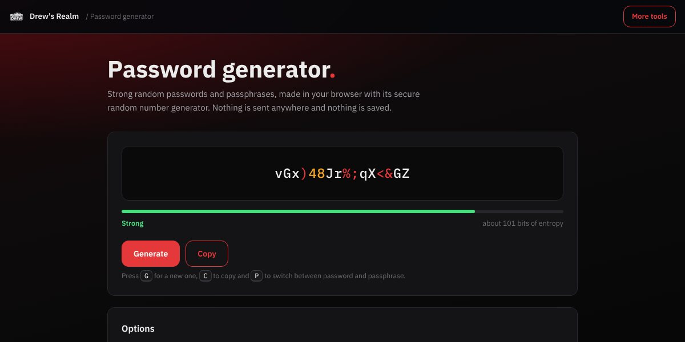

# Password generator



Strong random passwords and passphrases made in the browser. Live at <https://password-gen.drew-gnr.xyz/>.

## Features

- Uses `crypto.getRandomValues` with rejection sampling, so every character is equally likely
- Length from 8 to 64, with a slider and a number box
- Upper case, lower case, digits and symbols, each one on or off; at least one type always stays on
- Every password contains at least one character from each type you pick
- Optional "avoid look-alikes" setting drops `I O i l o 0 1 |`
- Strength meter with an entropy estimate in bits
- Passphrase mode: 3 to 10 random words from the [EFF long word list](https://www.eff.org/dice) (7,776 words, about 12.9 bits each), with a choice of dash, dot, underscore or space between them, optional capitals, and an optional digit added to one word
- Keyboard: <kbd>G</kbd> makes a new one, <kbd>C</kbd> copies it, <kbd>P</kbd> switches between password and passphrase
- Options are remembered in the browser. Passwords are never stored or sent anywhere

## Command-line version

`password_generator.py` needs Python 3.6 or newer and nothing else.

```bash
python3 password_generator.py
python3 password_generator.py -n 5 -l 24
python3 password_generator.py -n 1 -l 32 --no-symbols
python3 password_generator.py -p -n 3
python3 password_generator.py -p -n 1 -w 8 --separator space --capitalise
```

Flags: `-l/--length`, `-n/--count`, `--no-upper`, `--no-lower`, `--no-digits`, `--no-symbols`, `--allow-look-alikes`, and for passphrases `-p/--passphrase`, `-w/--words`, `--separator dash|dot|underscore|space`, `--capitalise`, `--no-number`. The word list is built into the script, so it is still a single file. Without `-n` in a terminal it asks you questions instead.

## Files

| Path | What it is |
| --- | --- |
| `index.html` | The page |
| `assets/generator.js` | Password, passphrase and strength logic, also loadable in Node |
| `assets/words.js` | The EFF long word list |
| `assets/app.js` | Page behaviour |
| `assets/theme.css`, `assets/ui.js` | Shared drew-gnr.xyz look and helpers |
| `assets/fonts/` | IBM Plex, self-hosted (SIL OFL, see `OFL.txt`) |
| `tests/generator.test.js` | `node tests/generator.test.js` |

## Credits

The word list is the EFF's long word list, published by the Electronic Frontier Foundation under [CC BY 3.0 US](https://creativecommons.org/licenses/by/3.0/us/).

## Hosting

Static files only. Serve the folder as it is; `CNAME` is set for GitHub Pages.
